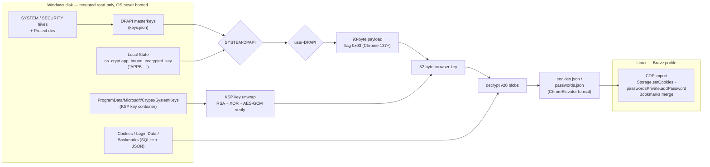

# chrome-offline-to-brave

Migrate a full Chrome profile — **cookies, saved passwords, bookmarks** —
from a Windows disk to a Linux Chromium-based browser (Brave), with the
Windows system **never booted**. The Windows partition is mounted
read-only; everything is decoded offline (Python + `impacket` +
`pycryptodomex`, no Windows binaries executed).

This includes the full offline defeat of Chrome's **App-Bound Encryption**
(flag `0x03`, Chrome 137+), recovering the browser key from the
`Local State → os_crypt.app_bound_encrypted_key` chain *without* running
any Windows code — existing public PoCs for this branch require a
live Windows session with admin/SYSTEM privileges.

> ## Ethics & threat model
>
> This is **not** an infostealer writeup. It documents migration of your
> **own** machine's data (the author's case: switching from Windows to
> Linux while keeping years of sessions). Everything here presumes physical
> access to the disk and the Windows login password of the user. On an
> owned machine that is legitimate data recovery / migration; against
> someone else's machine it is illegal access. If the disk is not yours,
> stop here.
>
> Note for defenders: this the same conclusion every DPAPI tool reaches —
> once an attacker has both the disk and the OS password, no browser-side
> local encryption will save the data. Real mitigation is full-disk
> encryption (e.g. BitLocker), not browser features.
>
> **No personal data is published here**: no usernames, URLs, key material
> or identifiers from the original run — only counts and formats.

## What moves and what doesn't

| Data | Migrates? | Notes |
|---|---|---|
| Cookies | ✔ ~99% | A few % have binary values and cannot pass CDP (auto-skipped; relogin manually) |
| Saved passwords | ✔ | Via the browser's own WebUI API (see troubleshooting) |
| Bookmarks | ✔ | JSON merge, wrapped in "Chrome …" folders |
| Autofill addresses / cards | ○ (script TODO) | same SQLite + key chain |
| Google-account profile *sync* | ✘ | Brave does not use Google sync; account state stays server-side |
| Chrome-on-Android passwords (`android://`) | ✔ | scheme preserved, groups by package |

## How it works (summary)



Full byte-level documentation: [`docs/PIPELINE.md`](docs/PIPELINE.md).
Brave/webkit-specific issues (empty password manager on KWallet, CDP traps):
[`docs/BRAVE_TROUBLESHOOTING.md`](docs/BRAVE_TROUBLESHOOTING.md).

## Record or watch a demo

See [`docs/DEMO.md`](docs/DEMO.md): a recipe for a ≤30-second GIF produced
entirely on synthetic data (IANA example domains, throwaway passwords).
`scripts/demo_make_inputs.py` builds the fake profile; the importers run
against a disposable browser profile, so nothing real ever appears on
screen.

## Repository layout

```
scripts/
  dpapi_keys_offline.py     mounted hive+Protect dirs → keys.json
  chrome_ab_chain.py        Local State + keys + KSP dir → browser key,
                            → decrypted cookies.json / passwords.json
                            (ChromElevator-compatible format)
  import_cookies.py         CDP importer (one cookie per call; binary-safe)
  import_passwords_cdp.py   bulk passwordsPrivate.addPassword importer
  convert_passwords.py      optional passwords.json → CSV (UI import)
  merge_bookmarks.py        Chrome Bookmarks JSON → target Bookmarks
  brave_kwalletd_fix.sh     fix for "password manager shows nothing"
  demo_make_inputs.py       synthetic profile for demo recordings (no real data)
docs/
  PIPELINE.md               the whole key chain, step by step
  BRAVE_TROUBLESHOOTING.md  pitfalls that cost real debugging time
  DEMO.md                   how to record a safe demo GIF
```

Dependencies (Arch names, equivalents anywhere):
`impacket` (tested 0.13.1), `python-pycryptodomex`, Python 3.10+.
No exotic requirements — the same libs the decryption needs are it.

## Quick start

1. Mount the Windows disk read-only:
   ```sh
   sudo mount -o ro,ntfs <windows-partition> /mnt/win
   ```
2. Extract DPAPI masterkeys (prompts for the Windows login password):
   ```sh
   python3 scripts/dpapi_keys_offline.py \
     --system /mnt/win/Windows/System32/config/SYSTEM \
     --security /mnt/win/Windows/System32/config/SECURITY \
     --system-protect /mnt/win/Windows/System32/Microsoft/Protect/S-1-5-18/User \
     --user-protect "/mnt/win/Users/<u>/AppData/Roaming/Microsoft/Protect/<SID>" \
     --sid <SID> -o keys.json
   ```
3. Recover the browser key and decrypt everything:
   ```sh
   python3 scripts/chrome_ab_chain.py \
     --local-state "/mnt/win/Users/<u>/AppData/Local/Google/Chrome/User Data/Local State" \
     --keys keys.json \
     --ksp-dir /mnt/win/ProgramData/Microsoft/Crypto/SystemKeys \
     --profile "/mnt/win/Users/<u>/AppData/Local/Google/Chrome/User Data/Default" \
     --profile "/mnt/win/Users/<u>/AppData/Local/Google/Chrome/User Data/Profile 1" \
     -o out
   ```
   → `out/<profile>/cookies.json`, `out/<profile>/passwords.json`.
4. Import into the target browser (see script docstrings for exact usage):
   ```sh
   python3 scripts/import_cookies.py --dir out/Default
   python3 scripts/import_passwords_cdp.py --dirs out/Default out/"Profile 1"
   python3 scripts/merge_bookmarks.py \
     --src /mnt/win/.../User\ Data/Default \
     --dst ~/.config/BraveSoftware/Brave-Browser/Default/Bookmarks
   ```
5. Clean up: close the browser without `--remote-debugging-port`, then
   `shred -u keys.json out/*/*.json passwords_import.csv` (or just work in
   a tmpfs from the start).

If the password list imports but shows empty in the UI — you hit the
KWallet trap; use `scripts/brave_kwalletd_fix.sh`.

## Provenance of the published constants

All hard-coded values used by Chrome itself (`KSP entropy`, `XOR key`,
flag-1/2 constant keys) appear in public research:
`runassu/chrome_v20_decryption` (this repo re-derives the offline KSP
variant of its flag-3 flow), the public Chromium tree
(`chrome/elevation_service/elevator.cc` — the parts behind
GOOGLE_CHROME_BRANDING live in Google's closed internal repo, which is why
the offline SystemKeys path had to be mapped from disk artifacts), and
`xaitax/Chrome-App-Bound-Encryption-Decryption` (whose JSON export formats
these scripts consume and match).

## Status / tested on

* Windows Chrome 137+ (flag 0x03 ABE), single physical machine, real-world
  profile: ~4400 cookies decrypted (~3620 imported, rest expired/dupes),
  236 passwords (3 merge-rejected), bookmarks across 2 profiles merged.
* Only flag `0x03`; flag `0x01`/`0x02` (Chrome ≤136) are documented but
  not coded against real data.
* Script-side error-handling is minimal; treat as research-grade, not a
  product. If a decrypt fails, it fails loudly (GCM verification oracle).

MIT licensed. Not affiliated with Google/Brave. Use responsibly.
